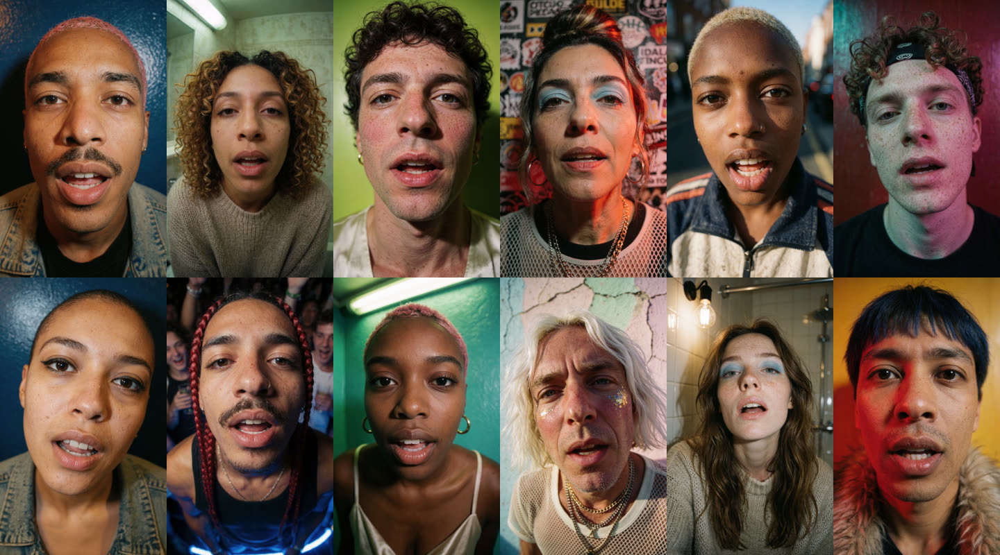

# OneShot MV

Give OneShot MV a song and one line about the world it lives in ("the gladiator games in ancient
Rome"). It listens to the song, invents a cast for that world, plans every shot around the song's
energy, and renders a lip-synced music video where a different invented person sings each line.
Everything runs locally in ComfyUI on open-weights models.



> Made for Comfy's Open Source Higgsfield challenge. Every face in this repo and in the videos it
> makes is invented. Use music you have the rights to.

## What it does

1. It analyses the song: beats, bars, sections, loudness, the drop, and the vocal and drum stems.
2. It turns your line into a World: who the people are, what they wear, where each scene happens,
   the light and the camera.
3. It plans the cut by energy. Each part of the song is low, medium or high energy, and each level
   is cut its own way: long shots in the quiet parts, a cut every bar in the verses, a new face on
   the beat in the chorus or drop.
4. Krea 2 paints a portrait of every performer, each one a different person.
5. A vision check looks at every portrait (one person, the right gender, the whole head in frame,
   no writing, nothing from after the World's period, the right outfit) and redoes the wrong ones.
6. LTX-2.3 turns each portrait into a clip that sings the isolated vocal.
7. A take check re-shoots missing, frozen or blown-out takes, dead mouths, takes that drift to
   another person or place, bad framing, and weak lip sync (scored with SyncNet).
8. A few shots become b-roll: a World character in a candid moment, not singing.
9. It cuts everything on the beat, adds audio-reactive FX driven by the drums, then a color grade,
   grain at 1080p and a vignette. You get an MP4, an EDL and a Final Cut Pro XML.

## Three ways to run it

| | Who it's for | What it is |
|---|---|---|
| The Studio (recommended) | Everyone | An app inside ComfyUI: the brief, the plan, live rendering, the result, post processing and re-shoots. |
| The ComfyUI workflow | People who build in ComfyUI | The Director node with every setting, or the same run in ComfyUI's App mode. |
| The Comfy SDK | Scripts and automation | `run_sdk.bat` or `sdk_run.py`: one command takes a song and a World line to an MP4. |

All three drive the same nodes, and every run shows up in the Studio under Your videos.

### The Studio

With ComfyUI running, open http://127.0.0.1:8188/oneshot-mv/ or click **OneShot MV** in
ComfyUI's top bar. ComfyUI serves the page itself, so there is nothing else to install.

1. **The Brief.** Name the project, then drop in a song. The waveform shows the low, medium and
   high energy sections and the stretch the video will use; click it to start somewhere else.
   Pick a length, a World (four examples, or write your own) and a format. The buttons say how
   long the plan and the video will take.
2. **The Plan.** The World the tool wrote and every shot (when, what energy, who, wearing what,
   where), before anything long renders. Change the World and plan again, or make the video.
3. **Rendering.** The stages (plan, stills, vision check, clips, take check, b-roll, edit), a
   storyboard that fills in as stills and clips arrive, notes from the checks, and the time left.
   You can close the tab and come back.
4. **Result.** The video, Download MP4, and Export XML for Premiere Pro or DaVinci Resolve (every
   clip with its in and out points). From here you can:
   - Re-shoot any shot. Click it and choose a new take of the same person or a new person, with
     a note on what to change ("a woman in her seventies, in bright sun"). Pick several and they
     shoot together; the video is then cut again, and the cut before stays as a version you can
     switch back to.
   - Change the post processing without re-rendering anything: audio-reactive FX for low, medium
     and high energy sections (None, Subtle or Intense), a color grade (None, Neon Saturated,
     Technicolor, Teal & Orange, Golden Hour, Warm Romantic, Soft Eterna, Low Key, Industrial
     Green or Silver Mono, each previewed on a still from your video), grain with a
     pixel-for-pixel 1080p preview, and a vignette. Apply changes makes the new cut in about two
     minutes.
5. **Your videos** lists every run, whether it came from the Studio, the workflow or the SDK.

Every video starts with FX on Subtle, no color grade (a natural base grade is always applied),
grain at 25% and the finest size, and no vignette. The project name is used for the run folder
and the downloaded files. The Look menu in the top bar switches the Studio between four color
palettes.

To click through every screen on a finished video without rendering anything, open
http://127.0.0.1:8188/oneshot-mv/?demo. Starting a video, rendering, Apply and re-shoots are
simulated there in seconds, and nothing is sent to ComfyUI.

### The ComfyUI workflow

Open an example from Templates in the left sidebar, under Extensions, ComfyUI-OneShotMV. You can
also drag a file from `example_workflows/` onto the canvas.

- `OneShotMV_App.json` opens in ComfyUI's App mode: a song, a World line and a few settings, then
  Run. App / Graph at the top left shows the graph behind it.
- `OneShotMV_Voice.json` is the Director with every setting.
- `OneShotMV_Recut.json` cuts a finished run again with other FX or without the finish.
- `OneShotMV_Motion.json` is the experimental motion mode (one dance, many dancers). It needs the
  extra models listed under "Models that only other packs and modes use".

Turn `queue_renders` off and run once to see the plan in the summary without rendering anything.
Then turn it on and run again; the song analysis and the World are cached, so the second run
starts faster. The Director queues every job itself, and the video lands in
`output/oneshot-mv/runs/<run>/final_<format>.mp4`.

### The Comfy SDK

`sdk_run.py` makes a whole video through the [Comfy SDK](https://pypi.org/project/comfy-sdk/). It
uploads the song, runs the Director and prints the shot plan. The run's stages then render in
ComfyUI, a Run Result job waits for the finished video, and the SDK downloads it into
`oneshot_mv_out/`.

Comfy Cloud doesn't install custom node packs yet, so the SDK talks to your own ComfyUI through
Comfy's open-source [`comfy-api-proxy`](https://github.com/Comfy-Org/comfy-api-proxy), which gives
a local ComfyUI the same API as Comfy Cloud. `sdk_run.py` starts the proxy for you; start ComfyUI
first.

On Windows with ComfyUI portable, double-click `run_sdk.bat` in the pack folder. The first time,
it installs `comfy-sdk` and `comfy-api-proxy` into `.sdk\` next to it and leaves ComfyUI's own
packages alone. It asks for the song (drag the file in), the World line and the length. You can
also pass options:

```
run_sdk.bat --song "song.wav" --theme "the gladiator games in ancient Rome" --seconds 40
```

Anywhere else:

```
pip install comfy-sdk comfy-api-proxy
python sdk_run.py --song track.wav --theme "a 1965 airline: pilots, stewardesses and passengers" --preview
python sdk_run.py --song track.wav --theme "a 1965 airline: pilots, stewardesses and passengers" --seconds 30
python sdk_run.py --song track.wav --format 9:16 --fx intense --cuts-high "to the music (intense)"
python sdk_run.py --recut "<run folder>" --fx none
```

`python sdk_run.py --help` lists every option: length and start, format, preset, seed, FX, the
cut for each energy level, cast order, crowd, b-roll share, take-check rounds and the model set. `--preview`
prints the plan without rendering. To use another deployment that has the OneShot MV nodes, set
`COMFY_BASE_URL`, and `COMFY_API_KEY` if it needs one.

## Writing a World

One line is enough. "The gladiator games in ancient Rome" gets you gladiators, an emperor,
senators and noblewomen in the arena, the stands and the imperial box, all in period clothes.

For more control, write it the way the Studio's examples are written: the tone, then the people
in the order you want them, then the places, then the light.

> A 1980s Florida retirement community, played completely straight and over the top: seniors in
> their seventies and eighties with big attitude, in velour tracksuits, sun visors, pearls, gold
> chains and oversized sunglasses, at aqua aerobics in the condo pool, the bingo hall, the
> shuffleboard court, the early-bird buffet and rows of golf carts; harsh Florida sun and
> sun-faded pastel colour

Some things that help:

- The people you name are cast first, in your order. Set cast order to "mixed" to shuffle them.
- Name the period ("1965", "ancient Rome", "1813"). It keeps modern clothes and objects out, and
  the vision check rejects stills that show them.
- Say the tone: "played straight like an epic film", "over the top", "cinematic".
- Casts are adults only. Give ages when they matter ("in their seventies").
- Say whether it's night or day ("at 3 a.m.", "hard midday sun"), and the light follows.
- For events such as a stadium, a ball or a club, people appear behind the singers, dressed for
  the World. The crowd setting turns this on or off.
- Leave out real people and brands. Brand names are replaced, and signs are kept free of writing.

## Settings

| Setting | Choices | Default |
|---|---|---|
| Length and start | seconds (0 = the whole song); a start time, or auto | 30 s from the strongest stretch |
| Format | 16:9 (1920×1080), 9:16 (1080×1920), 1:1 (1080×1080) | 16:9 |
| Quality | quality (50 fps renders), fast (25 fps) | quality |
| Cuts, per energy level | every 2 bars, every bar, to the music (subtle), to the music (intense) | low: every 2 bars; medium: every bar; high: to the music (subtle) |
| Audio-reactive FX | none, subtle, intense (per energy level in the Studio) | subtle |
| Cast order | as written, mixed | as written |
| Crowd behind singers | auto, on, off | auto |
| B-roll share | 0 to 0.5 of the shots | 0.125 |
| Take-check rounds | 0 to 3 | 2 |
| Seed | any number | 1 |
| Models | auto, 24gb (fp8), full (bf16, 48 GB+ GPUs) | auto |

"To the music" cuts on the beat to a new face in the same spot: about every half bar on subtle,
about every beat on intense.

## Install

1. Clone the pack into `ComfyUI/custom_nodes/` and restart ComfyUI:
   ```
   cd ComfyUI/custom_nodes
   git clone https://github.com/VisualFrisson/ComfyUI-OneShotMV
   ```
   Then install its three Python packages (numpy, OpenCV and imageio-ffmpeg) with ComfyUI's
   Python. For ComfyUI portable on Windows, from the pack folder:
   ```
   ..\..\..\python_embeded\python.exe -m pip install -r requirements.txt
   ```
   Otherwise `pip install -r requirements.txt` in ComfyUI's environment.
2. Install these node packs: [ComfyUI-LTXVideo](https://github.com/Lightricks/ComfyUI-LTXVideo),
   [ComfyUI-KJNodes](https://github.com/kijai/ComfyUI-KJNodes) (the LTX attention tuner and Sage
   attention) and [RES4LYF](https://github.com/ClownsharkBatwing/RES4LYF) (samplers). OneShot MV
   was built on ComfyUI 0.39; it needs a recent ComfyUI for the core Generate Text node, Krea 2
   and App mode.
3. Download a model set (see [Two model sets](#two-model-sets)): the 24 GB set for most cards,
   the full set if your GPU has 48 GB or more. Diffusion models go in `models/diffusion_models`,
   LoRAs in `models/loras`, text encoders in `models/text_encoders`, VAEs in `models/vae`, the
   LTX-2.3 checkpoint in `models/checkpoints` and its upscaler in `models/latent_upscale_models`.
   Sub-folders are fine: OneShot MV looks each file up by name. If you rename a file, change its
   name in `fv/models.json` (24 GB set) or `fv/models_full.json` (full set).
4. Optional, but recommended, the checks:
   - Lip sync (SyncNet): put `syncnet_v2.model` and `sfd_face.pth` in `ComfyUI/models/syncnet/`.
     They come from the [Oxford VGG SyncNet page](https://www.robots.ox.ac.uk/~vgg/software/lipsync/)
     and are mirrored in [syncnet-python](https://github.com/nawta/SyncNet_py309_313/tree/main/weights).
     Without them the take check skips lip sync.
   - Framing: insightface's buffalo_l face models (`det_10g.onnx`, `w600k_r50.onnx`, for
     non-commercial research use only) in `ComfyUI/models/insightface/models/buffalo_l/`. They run
     with onnxruntime (`pip install onnxruntime-gpu` with ComfyUI's Python). Without them the
     framing checks are skipped.
   - Speed: [SageAttention](https://github.com/thu-ml/SageAttention) makes the LTX clips faster.
     If it isn't installed, the jobs run without it. The default kernel in `fv/models.json`
     (`ltx23_sage`) needs an RTX 40 or 50 series card; set it to `auto` on older cards.
   - The vocal and drum stems use torchaudio's Hybrid Demucs, which downloads its weights the
     first time it runs.

### Hardware and time

The default model set is made for 24 GB GPUs (RTX 3090, 4090 or 5090) and wants at least 64 GB of
system RAM, because ComfyUI keeps part of LTX-2.3 in RAM while it renders. The full set wants a
GPU with 48 GB or more. The Studio's Quality box, the Director's `models` setting and
`sdk_run.py --models` choose the set; Auto uses the full set on a 48 GB+ GPU when its files are
installed, and the 24 GB set otherwise. The Studio also lists any files the chosen set is missing.

OneShot MV was built and tested on an NVIDIA RTX PRO 6000 (96 GB) with the full set. Times on that
card:

| Video | Time |
|---|---|
| 32 s, quality | about 70 min |
| 1:51, quality | about 6 h 45 min |
| Re-cut (post processing) | about 2 min |
| Re-shoot one shot | about 10 to 15 min, mostly model loading |

On a cold start, loading LTX-2.3 and its Gemma 3 text encoder (about 65 GB with the full set)
takes 5 to 9 minutes from a SATA SSD and about a minute from NVMe. The 24 GB set has not been
timed on a 24 GB card yet; expect it to be slower than the times above.

## What a run leaves behind

Each run has its own folder, `output/oneshot-mv/runs/<run>/`, with:
- `final_<format>.mp4`, the EDL, and the XML once you export it;
- `plan.json` (the World, the cast and every shot) and the check reports;
- every portrait, clip and job (in `jobs/`), so any shot can be queued again.

## Troubleshooting

- No OneShot MV button or page: restart ComfyUI once after installing, and look in the console
  for import errors from the pack.
- "Model not found" or "Value not in list": a file of the chosen model set is missing. The
  Studio's Quality box lists the missing files; download them, or pick the other set.
- The lip-sync or framing checks were skipped: their weights aren't installed (Install, step 4).
  The video is still made.
- A run stopped partway: the Studio's Rendering screen says so, and the ComfyUI console shows the
  error. Runs queued together render one after another.
- Off-theme people or modern things in a period World: name the period and the people in the
  World line, then re-shoot the wrong shots from the Result screen with a note.
- Slow sampling on Windows with `--highvram`: ComfyUI keeps LoRA weight backups on the GPU and
  overflows into shared memory. The Director adds Weight Backups to RAM after the LTX loaders to
  prevent this.

## Nodes

| Node | What it does |
|---|---|
| OneShot MV: Director | Takes a song and a World line, then plans, casts and queues the whole run. |
| OneShot MV: Vision Check | Checks every portrait and b-roll still and redoes the wrong ones (the Director queues it). |
| OneShot MV: Take QC | Checks every take, lip sync included, re-shoots bad ones, then queues the cut. |
| OneShot MV: Assemble | Cuts a run together with FX and the finish. Run it again to re-cut; nothing re-renders. |
| OneShot MV: Run Result | Reports where a run is and returns the finished video as a job output (the SDK uses it). |
| OneShot MV: Theme Preview | Shows what a World line turns into before you spend a run on it. |
| OneShot MV: Lip Sync Score | Scores a finished run's lip sync with SyncNet, take by take. |
| OneShot MV: Finish | Applies the finish (grade, grain, vignette) to any frames. |
| OneShot MV: Keep Models Loaded, Weight Backups to RAM, Free Memory | Memory helpers for the Director's jobs. |
| OneShot MV: Load Image / Video / Audio (path) | Loaders for the Director's jobs. |
| OneShot MV: Face Match, Lead Dancer Pose, Lead Dancer Only | Older experiments: one-artist looks and motion mode. |

The style packs live in `fv/packs/`, one JSON file each, holding the casting rules, the edit and
the effects. `crowd` (the default) puts a different stranger on every line, close and to camera.
`eras` casts people from every era, and `artist` puts one singer from one photo in a new look in
every shot. The dance-driven motion packs (`spotlight`, `wardrobe`) are experimental.

## Models and licences

The code is MIT. The models are open weights under their own terms, and none are included here.
In short: for companies under US$1M in annual revenue, the default models (Krea 2, LTX-2.3,
Gemma 3) allow commercial use, outputs included. The optional insightface face models are for
non-commercial research only, and LTX's licence asks you to label what you publish as
AI-generated. Read each licence before you rely on it.

### Two model sets

The 24 GB set (the default) uses fp8 files; the full set uses the original bf16 files. Both use the
same LoRAs, upscaler and VAE.

| Model | 24 GB set (default) | Full set (48 GB+) | Download |
|---|---|---|---|
| LTX-2.3 22B dev | `ltx-2.3-22b-dev-fp8.safetensors`, 29.1 GB | `ltx-2.3-22b-dev.safetensors`, 46.1 GB | [Lightricks/LTX-2.3-fp8](https://huggingface.co/Lightricks/LTX-2.3-fp8), [Lightricks/LTX-2.3](https://huggingface.co/Lightricks/LTX-2.3) |
| Gemma 3 12B IT | `gemma_3_12B_it_fp8_scaled.safetensors`, 13.2 GB | `gemma_3_12B_it.safetensors`, 24.4 GB | [Comfy-Org/ltx-2](https://huggingface.co/Comfy-Org/ltx-2/tree/main/split_files/text_encoders) |
| Krea 2 Turbo | `krea2_turbo_fp8_scaled.safetensors`, 13.1 GB | `krea2_turbo_bf16.safetensors`, 26.3 GB | [Comfy-Org/Krea-2](https://huggingface.co/Comfy-Org/Krea-2) |
| Krea 2 Raw | `krea2_raw_fp8_scaled.safetensors`, 13.1 GB | `krea2_raw_bf16.safetensors`, 26.3 GB | [Comfy-Org/Krea-2](https://huggingface.co/Comfy-Org/Krea-2) |
| Qwen3-VL 4B (Krea 2's text encoder) | `qwen3vl_4b_fp8_scaled.safetensors`, 5.2 GB | `qwen3vl_4b_bf16.safetensors`, 8.9 GB | [Comfy-Org/Krea-2](https://huggingface.co/Comfy-Org/Krea-2) |
| Both sets | The LTX-2.3 distilled LoRA 384 v1.1 (7.6 GB), the IC-LoRA Detailer (about 2.4 GB), Crisp and Soft Enhance (about 0.7 GB), the spatial upscaler x2 v1.1 (1.0 GB), the Krea 2 Turbo LoRA (0.5 GB) and the Qwen-Image VAE (0.25 GB) | | See the table below |

In all, the 24 GB set is about 86 GB to download and the full set about 144 GB.

A default run (voice mode, `crowd` pack) uses:

| Model | Used for | Licence | Download |
|---|---|---|---|
| Krea 2 Turbo and Raw, the Turbo LoRA (rank 64), the Qwen3-VL 4B text encoder and the Qwen-Image VAE | Every portrait and b-roll still | Krea 2 Community License: commercial use of the model and its images only for companies under US$1M annual revenue (Qwen3-VL and the VAE are Apache-2.0 upstream) | [Comfy-Org/Krea-2](https://huggingface.co/Comfy-Org/Krea-2) |
| LTX-2.3 22B dev, the distilled LoRA 384 v1.1 and the spatial upscaler x2 v1.1 | Every clip: lip sync and b-roll | LTX-2 Community License: free under US$10M annual revenue; label output as machine-generated; no impersonation without consent | [Lightricks/LTX-2.3](https://huggingface.co/Lightricks/LTX-2.3) |
| LTX-2 19B IC-LoRA Detailer | Fine detail in every clip | LTX-2 Community License | [Lightricks/LTX-2-19b-IC-LoRA-Detailer](https://huggingface.co/Lightricks/LTX-2-19b-IC-LoRA-Detailer) |
| LTX2.3 Crisp Enhance and Soft Enhance (community LoRAs by vrgamedevgirl84) | Sharpness and detail in every clip | No licence stated by the author. To run without them, remove them from `ltx23_loras` in `fv/models.json` | [CivitAI: LTX 2.3 Enhancers](https://civitai.com/models/2535622/ltx-23-enhancers) |
| Gemma 3 12B IT | LTX-2.3's text encoder; it also writes the World and the b-roll prompts and runs the vision check | Gemma Terms of Use and Prohibited Use Policy | [Comfy-Org/ltx-2](https://huggingface.co/Comfy-Org/ltx-2/tree/main/split_files/text_encoders) |
| Hybrid Demucs (`HDEMUCS_HIGH_MUSDB_PLUS`) | Vocal and drum stems | Code MIT; no separate weights licence is published | Downloaded by torchaudio on first use |

The optional checks (Install, step 4):

| Model | Used for | Licence | Download |
|---|---|---|---|
| SyncNet v2 and the S3FD face detector | Lip-sync scores and each take's sync offset | Research use under CC-BY (Oxford VGG); no licence stated for S3FD | [VGG SyncNet page](https://www.robots.ox.ac.uk/~vgg/software/lipsync/) |
| insightface buffalo_l (`det_10g`, `w600k_r50`) | Framing and identity checks | Non-commercial research use only | [insightface model zoo](https://github.com/deepinsight/insightface/tree/master/model_zoo) |

Models that only other packs and modes use (a default run never loads them):

| Model | Used for | Licence | Download |
|---|---|---|---|
| FLUX.2 [klein] 9B fp8, its Qwen3 8B text encoder and the FLUX.2 small-decoder VAE | Look keyframes in the `eras` and `artist` packs; motion mode | FLUX Non-Commercial License (outputs may be used commercially); the VAE is Apache-2.0 | [black-forest-labs/FLUX.2-klein-9b-fp8](https://huggingface.co/black-forest-labs/FLUX.2-klein-9b-fp8), [Comfy-Org/flux2-klein-9B](https://huggingface.co/Comfy-Org/flux2-klein-9B), [FLUX.2-small-decoder](https://huggingface.co/black-forest-labs/FLUX.2-small-decoder) |
| LTX-2.3 IC-LoRA Union Control (ref0.5) | Pose-matched looks; motion mode | LTX-2 Community License | [Lightricks/LTX-2.3-22b-IC-LoRA-Union-Control](https://huggingface.co/Lightricks/LTX-2.3-22b-IC-LoRA-Union-Control) |
| DWPose and YOLOX-L (TorchScript) | Pose guides for looks and motion mode | Apache-2.0 | Downloaded by [comfyui_controlnet_aux](https://github.com/Fannovel16/comfyui_controlnet_aux), which these packs and modes also need |
| Qwen-Image 2.1, its VAE and the Qwen3-VL 8B text encoder | Portraits in the `artist` pack | Check the licence on the model page before commercial use | [Comfy-Org/Qwen-Image-2.1](https://huggingface.co/Comfy-Org/Qwen-Image-2.1) |
| LTX-2.5 22B distilled, its VAEs, upscaler and Gemma 4 text encoder | Motion mode at the `fast` preset | LTX-2.x Community License | [Lightricks/LTX-2.5](https://huggingface.co/Lightricks/LTX-2.5) |

File names are set in `fv/models.json` and `fv/models_full.json`.

## Licence

The code is MIT (see `LICENSE`). Vendored code keeps its own licence (`fv/syncnet/`, see its
NOTICE file). The models are under their own licences, listed above, and are not included. Only
publish videos made with music you have the rights to, label them as AI-generated, and only cast
invented people or people who have agreed to it.
