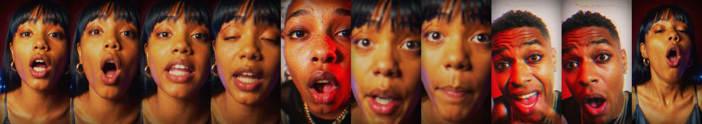
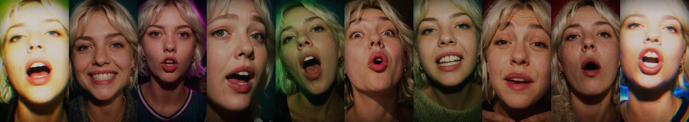
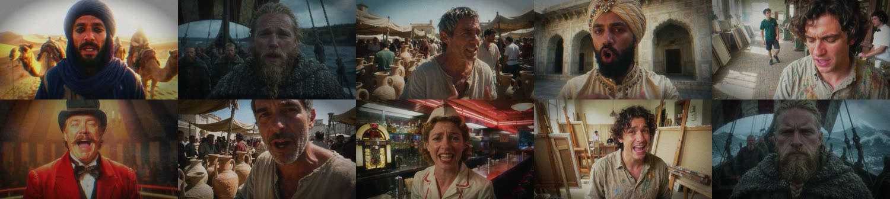
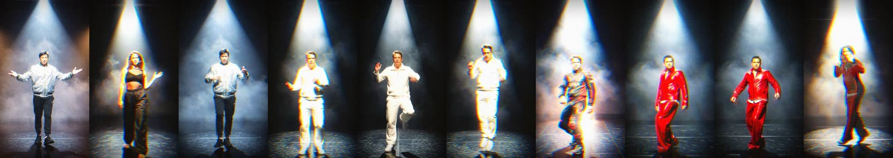

# Frisson Vision

**One performance, many performers.** Drop in a song and Frisson Vision makes a music video
where a different person sings every line. It holds on the verses and cuts on the beat through
pose-matched looks of the same moment on the drop, drives light and colour from the drums, and
finishes the picture like film. Drop in a dance clip instead, and a new dancer takes over the
same choreography.

Everything runs locally in ComfyUI on open-weights models:
- **Krea 2** casts the faces.
- **LTX** performs them, lip-syncing to the isolated vocal and following a dance's pose.
- **FLUX.2 Klein** dresses the pose-matched looks.

The cut, the effects and the finish come from the song itself.


> Status: work in progress for the Comfy "Open Source Higgsfield" challenge. Every face shown here is invented.

## What it does

| Mode | Input | What you get |
|---|---|---|
| **Voice** | a song (optionally one photo of the artist) | A crowd of strangers, people from every era, or one artist in a new look every shot. Each sings their line to camera. Verses hold each shot; the drop cuts on the beat, every cut a match cut. |
| **Motion** | a song and a dance clip | One choreography, a new character every two bars in the quiet parts and every two beats on the drop. Every cut is pose-aligned, so it reads as a transformation, not a jump. A crew dancing behind the lead stays out of it: only the lead dancer's pose guides the render. |

**Match cuts on the drop.** Each cut lands the next face where the last one was:



**One artist, a new look on every line** (from one photo):



**Every era, in 16:9:**



**Motion: one dance, many dancers**, flickering on the drop to a second character doing the same move:



The Director does the whole run from one press of Queue:

1. **Listens.**
   - Beats, bars, sections, loudness and the drop (`fv/beat.py`).
   - Vocal and drum stems with Hybrid Demucs (`fv/stems.py`).
2. **Plans the cut** in the chosen style pack (`fv/plan.py`):
   - splits the song into quiet stretches, builds and drops (the drop and the choruses);
   - shots on bar lines: two bars in the quiet stretches, one in the build;
   - on the drop, one-bar groups, each a chain of pose-matched looks of the same moment;
   - wide, medium and close shots in the quiet stretches (`mixed` framing).
3. **Casts** every performer from the pack's casting grammar (`fv/casting.py`). It writes the portrait prompt and the performance prompt for each.
4. **Queues the renders, grouped by model** so each model loads once:
   1. Krea 2 portraits (or Qwen-Image identity edits of the artist photo);
   2. LTX lip-sync clips;
   3. keyframes for the pose-matched looks;
   4. the pose-guided LTX looks;
   5. take QC;
   6. the final cut.
5. **Checks every take** (`fv/qc.py`). A take is re-rendered with a new seed before the cut if it:
   - is missing, frozen or blown out;
   - has a dead mouth;
   - cuts away (or slowly drifts) from the planned shot to another person, place or framing mid-take, which LTX sometimes does;
   - **is out of lip sync**, by SyncNet (`fv/lipsync.py`, see Install). SyncNet also measures how far each take's mouth runs ahead of the voice, and the cut shows that take that much later.

   The worst takes are re-rendered first, and re-renders stop once they would double the run's render time. A re-rolled lead clip also re-renders its pose-matched looks. The best take of each shot goes into the cut.
6. **Cuts it together** (`fv/assemble.py`):
   - **The edit.** Every shot plays its lead performer, and the cut never goes back to a shot it has left. Quiet stretches hold; the build tightens; the drop steps through each group's chain of looks on the beat.
   - **Match cuts.** Fast cutting only works when the eye has somewhere to rest. Each look in a drop chain is rendered from the lead's own pose and words (DWPose plus the LTX union-control IC-LoRA, keyframed from the lead's frame at that beat), so the next look lands on the same pose and syllable. The assembler tracks every face (`fv/faces.py`), nudges each look so the faces line up exactly, and skips a look whose face doesn't land. Motion runs get the same effect on the drop: each segment is rendered twice from the same pose guide, so every flicker lands on the same move.
   - **Lip sync.** LTX's mouths run slightly ahead of its audio. SyncNet measures each take's offset, and the cut shows that take that much later. Without SyncNet, each preset shows its clips by an average measured offset (`sync_delay` in `fv/formats.py`).
   - **Effects.** Exposure flashes, bloom, zoom punches, shake, RGB split and motion trails, driven by the kick, snare and hat envelopes and the drop (`fv/audiofx.py`, `fv/fx.py`). They stay low in the quiet stretches and rise through the build, so the drop lands at full strength.
   - **The finish** (`fv/finish.py`): a grade learned from a reference edit, halation, glow, contrast, a gate vignette and grain.
   - **Output.** It scales to the delivery size, muxes the song, and writes an EDL so the cut opens in Resolve or Premiere.

## Style packs

A style pack is one JSON file in `fv/packs/` holding the casting grammar, the edit grammar, the effects map and the finish. Copy one, change it, and the tool takes on a new style.

| Pack | Mode | Look |
|---|---|---|
| `crowd` | voice | Extreme close-ups on a wide lens, flash and practical light against saturated walls; warm grade, halation, grain. A new face every shot. |
| `eras` | voice | Invented people from every era and corner of the world, each in their own setting. |
| `artist` | voice | **One artist from one photo.** Every shot puts the same person in a new outfit, light and place; on the drop, each beat is a quick costume change on the same pose. |
| `spotlight` | motion | One hazy stage under a single spotlight. The dancer's look flickers on the beat between two characters doing the same move, faster as the section builds, with motion trails. |
| `wardrobe` | motion | A new character and a new world on every switch, with same-move flickers in the loud parts. |

The `crowd` and `spotlight` finishes were measured from reference edits (the Lab mean and standard deviation of their frames). `Frisson Vision: Finish` applies any pack's finish to any frames.

**Framing** (voice):
- `mixed` (default): wide, medium and close shots in the quiet stretches, medium and close in the build, close-ups on the drop. In the `artist` pack, the wide and medium shots also move the artist somewhere new, doing something: dancing, walking, turning to the camera.
- `close`: close-ups only.

## Formats and presets

| Format | Quality render | Fast motion render | Delivered |
|---|---|---|---|
| 16:9 (default) | 1280×768 | 896×512 | 1920×1080 |
| 9:16 | 768×1280 | 512×896 | 1080×1920 |
| 1:1 | 1024×1024 | 768×768 | 1080×1080 |

Render sizes are a touch off the exact aspect: the stage-1 size of the multi-stage pipeline must be a multiple of 64 for the pose guide. The cut is centre-cropped to the delivery aspect.

**Presets**
- **quality** (default): LTX-2.3 22B dev with the distilled, detailer, crisp and soft LoRAs. Three stages (¼ → ½ → full), 50 fps, an audio-to-video attention boost.
- **fast**:
  - voice: the quality model at its full size, 25 fps, with fewer first-stage steps. Singing always uses LTX-2.3: its lip sync is the stronger of the two;
  - motion: LTX-2.5 22B distilled, two stages, 25 fps. About 15 s per clip on an RTX PRO 6000.

## Nodes

| Node | Purpose |
|---|---|
| **Frisson Vision: Director** | Takes a song, plus an optional artist photo or dance clip. Plans, casts and queues the whole run. |
| **Frisson Vision: Take QC** | Checks every take, lip sync included, and re-rolls bad ones, then queues the cut (queued by the Director). |
| **Frisson Vision: Lip Sync Score** | Scores a finished run's lip sync with SyncNet, take by take, into `<run>/lipsync.json`. |
| **Frisson Vision: Assemble** | Cuts a run together. Queue it again to re-cut with different FX intensity; nothing re-renders. |
| **Frisson Vision: Finish** | A pack's finish on any frames. |
| **Frisson Vision: Weight Backups to RAM** | Keeps LoRA weight backups in system RAM (see Performance). |
| **Frisson Vision: Lead Dancer Pose** | Keeps only the lead dancer in a DWPose guide (queued by the Director for motion runs). |
| **Frisson Vision: Lead Dancer Only** | Greys out everyone but the lead dancer in a frame before the keyframe edit. |
| Load Image / Video / Audio (path), Free Memory | Helpers the Director's jobs use. |

## Install

1. Clone into `ComfyUI/custom_nodes/` and restart ComfyUI.
2. Required node packs:
   - ComfyUI-LTXVideo;
   - comfyui_controlnet_aux (DWPose);
   - RES4LYF (samplers for the Krea 2 redetail and the quality preset);
   - ComfyUI-KJNodes (Sage attention and the LTX attention tuner).
3. Models. Edit `fv/models.json` to match your folders.
   - **Krea 2:** Turbo, RAW, the Turbo LoRA, and the Qwen3-VL 4B encoder.
   - **Quality (LTX-2.3):** 22B dev, its LoRAs, the spatial upscaler and the Gemma 3 encoder.
   - **Fast (LTX-2.5):** 22B distilled, its VAEs, the Gemma 4 encoder and the upscaler.
   - **LTX union-control IC-LoRA.**
   - **FLUX.2 Klein 9B** for twin and character keyframes.
   - **Qwen-Image 2.1** for the artist pack.
4. `pip install -r requirements.txt`. This installs imageio-ffmpeg for encoding and OpenCV for face tracking. Match cuts use OpenCV 4's Haar cascades, which OpenCV 5 no longer ships. With OpenCV 5 the cut still works, but the looks aren't face-aligned.
5. **Lip-sync scoring (recommended).** Put the two SyncNet weight files in `ComfyUI/models/syncnet/`:
   - `syncnet_v2.model`;
   - `sfd_face.pth`.

   They come from the [Oxford VGG SyncNet page](https://www.robots.ox.ac.uk/~vgg/software/lipsync/), and are also mirrored in [syncnet-python](https://github.com/nawta/SyncNet_py309_313/tree/main/weights). The weights are for research use (Creative Commons Attribution), so they are not shipped here. The model code is vendored in `fv/syncnet/` (MIT and Apache-2.0, see its NOTICE). Without the weights, take QC skips the lip-sync check.

## Use it

**In ComfyUI.** Open one of the example workflows (Workflow → Browse Templates → Frisson Vision, or `example_workflows/`):
- `FrissonVision_Voice.json`: a song in, the crowd or artist cut out. For the artist pack, un-bypass the Load Image node.
- `FrissonVision_Motion.json`: a song and a dance clip in.
- `FrissonVision_Recut.json`: re-cut a finished run with different FX intensity.

Press Queue once. The Director queues every job, and the finished video lands in `output/frissonvision/runs/<run>/final_<format>.mp4`. Next to it you'll find:
- the plan;
- the QC report;
- the EDL;
- every portrait, clip and job.

To re-roll one shot, re-queue its file from `<run>/jobs/`, then re-cut.

**With the Comfy SDK** (`sdk_run.py`), the script drives the whole run through the Comfy API v2:
1. The Director plans.
2. The SDK submits every render.
3. Take QC returns re-rolls, which the SDK submits.
4. Assemble runs and the SDK downloads the MP4.

Point it at your own ComfyUI through `comfy-api-proxy`, or at a Comfy API deployment:

```
pip install comfy-sdk comfy-api-proxy
comfy-api-proxy --max-upload-mb 2000                  # beside your ComfyUI
export COMFY_BASE_URL=http://127.0.0.1:8189
python sdk_run.py --song track.mp3 --pack crowd --seconds 30
python sdk_run.py --song track.mp3 --pack artist --artist me.png --format 9:16
python sdk_run.py --song track.mp3 --mode motion --dance dance.mp4 --pack spotlight --format 1:1
```

## Performance notes

- A 30 s voice run is about 40–100 jobs: portraits, lead clips, look keyframes and the short look clips for each drop. On an RTX PRO 6000:
  - quality: about 1 minute per clip, about 45 minutes for a 30 s run;
  - fast: about 15 s per clip.
  
  Model loads dominate a cold start: about 4 minutes per model from a hard disk.
- **Re-cuts are free.** Face tracks are cached in `<run>/faces.json`, and Assemble re-derives the edit from the pack each time. You can change a pack's edit settings (`match_threshold`, `insert_on_beat`, and so on) and re-queue Recut without re-rendering.
- **`--highvram` and LoRAs.** In high-VRAM mode ComfyUI keeps the original weights behind every LoRA patch on the GPU. With the quality preset's four LoRAs on a 22B model, that doubles its footprint. On Windows the overflow spills into shared memory, and sampling gets many times slower. The Director inserts **Weight Backups to RAM** after the LTX loaders to prevent this.

## Licence

MIT (see `LICENSE`). Models are under their own licences. Only publish edits made with music and footage you have the rights to, and only cast invented people or people who have agreed to it.
