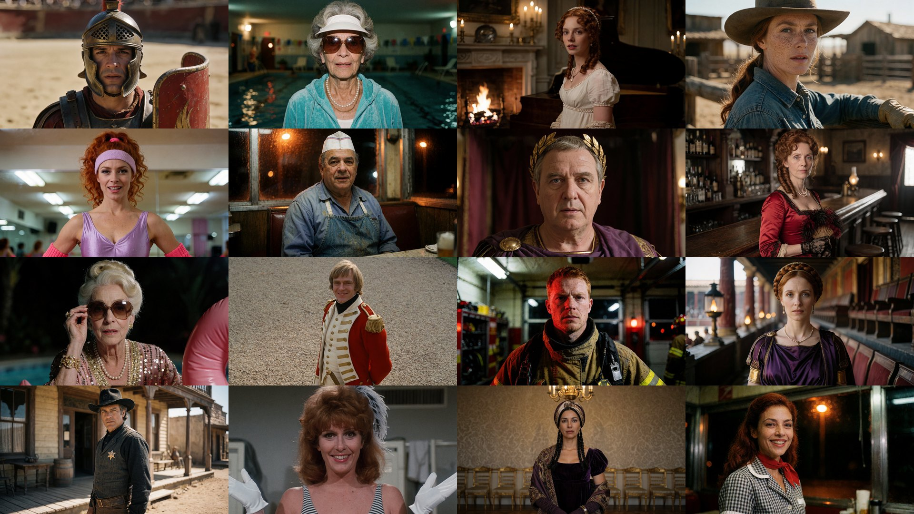
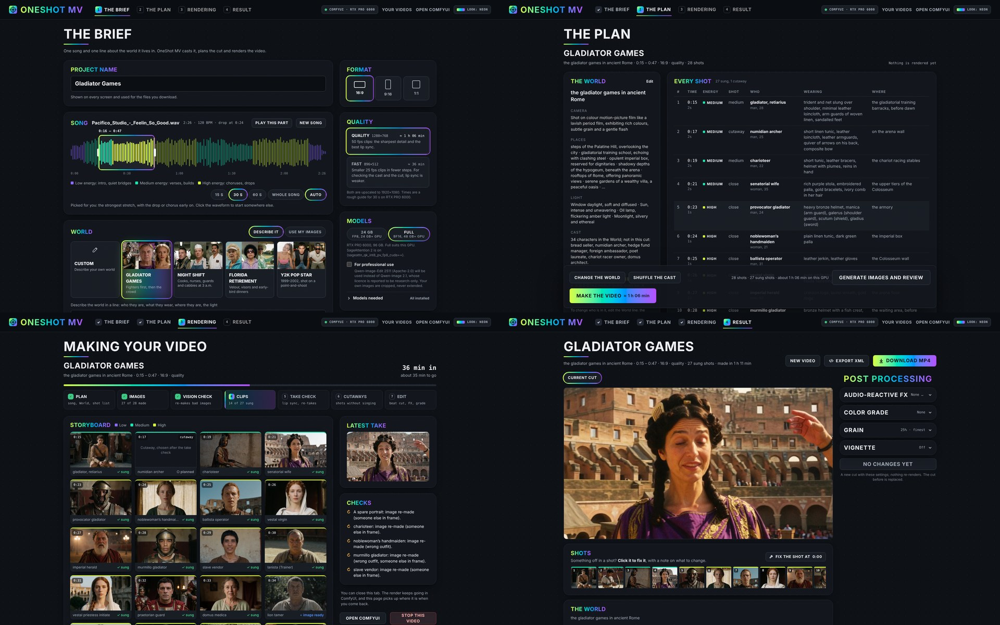

# OneShot MV

Give OneShot MV a song and one line about the world it lives in ("the gladiator games in ancient
Rome"). It listens to the song, invents a cast for that world, plans every shot around the song's
energy, and renders a lip-synced music video where a different invented person sings each line,
or one singer sings them all (Single Artist). Everything runs locally in ComfyUI on open-weights
models.



> Made for Comfy's Open Source Higgsfield challenge. Every face in this repo and in the videos it
> makes is invented. Use music you have the rights to.

## What it does

1. It analyses the song: beats, bars, sections, loudness, the drop, and the vocal and drum stems.
2. It turns your line into a World: who the people are, what they wear, where each scene happens,
   the light and the camera.
3. It plans the cut by energy. Each part of the song is low, medium or high energy, and each level
   is cut its own way: long shots in the quiet parts, a cut every bar in the verses, a new face on
   the beat in the chorus or drop.
4. Krea 2 paints a portrait of every performer, each one a different person.
5. A vision check looks at every portrait (one person, the right gender, the whole head in frame,
   no writing, nothing from after the World's period, the right outfit) and redoes the wrong ones.
6. LTX-2.3 turns each portrait into a clip that sings the isolated vocal.
7. A take check re-shoots missing, frozen or blown-out takes, dead mouths, takes that drift to
   another person or place, bad framing, and weak lip sync (scored with SyncNet).
8. A few shots become b-roll: a World character in a candid moment, not singing.
9. It cuts everything on the beat, adds audio-reactive FX driven by the drums, then a color grade,
   grain at 1080p and a vignette. You get an MP4, an EDL and a Final Cut Pro XML.

## Three ways to run it

| | Who it's for | What it is |
|---|---|---|
| The Studio (recommended) | Everyone | An app inside ComfyUI: the brief, the plan, live rendering, the result, post processing and re-shoots. |
| The ComfyUI workflow | People who build in ComfyUI | The Director node: a song, a World and the same settings the Studio has, also in ComfyUI's App mode. |
| The Comfy SDK | Scripts and automation | `run_sdk.bat` or `sdk_run.py`: one command takes a song and a World line to an MP4. |

All three drive the same nodes, and every run shows up in the Studio under Your videos.

### The Studio

With ComfyUI running, open http://127.0.0.1:8188/oneshot-mv/ or click **OneShot MV** in
ComfyUI's top bar. ComfyUI serves the page itself, so there is nothing else to install.



1. **The Brief.** Name the project, then drop in a song. The waveform shows the low, medium and
   high energy sections and the stretch the video will use; click it to start somewhere else.
   Pick a length, a World (four examples, write your own, or use a folder of your own images), who
   sings (Crowd or Single Artist) and a format. The buttons say how long the plan and the video will take.
2. **The Plan.** The World the tool wrote and every shot (when, what energy, who, wearing what,
   where), before anything long renders. Change the World and plan again, then **Make the video**,
   or **Generate images and review** to see every still before any clip is made. A World from your
   own images has it only with Extend, to check the drawn-in edges; cropped, they are the stills.
3. **Rendering.** The stages (plan, stills, vision check, clips, take check, b-roll, edit), a
   storyboard that fills in as stills and clips arrive, notes from the checks, and the time left.
   You can close the tab and come back. With Generate images and review, it stops once the stills
   are made: **Fix image** on any, cutaways too, makes it again with a note on what to change ("older, in
   a raincoat, harder light"), as many rounds as you like, then press Make the video. With your own
   images, **New image** swaps a shot's picture for another from your folder or one you upload
   (it goes to `input/oneshot-mv/added/<video>`), cropped around the face or extended (the video's
   choice unless you change it there), with a preview of the frame it makes; a sung shot takes only
   an image with a face big enough to sing.
4. **Result.** The video, Download MP4, and Export XML for Premiere Pro or DaVinci Resolve (every
   clip with its in and out points). From here you can:
   - Re-shoot any shot. Click it and choose a new take of the same person or a new person, with
     a note on what to change ("a woman in her seventies, in bright sun"). Pick several and they
     shoot together; the video is then cut again, and the cut before stays as a version you can
     switch back to.
   - Change the post processing without re-rendering anything: audio-reactive FX for low, medium
     and high energy sections (None, Subtle or Intense), a color grade (None, Neon Saturated,
     Technicolor, Teal & Orange, Golden Hour, Warm Romantic, Soft Eterna, Low Key, Industrial
     Green or Silver Mono, each previewed on a still from your video), grain with a
     pixel-for-pixel 1080p preview, and a vignette. Apply changes makes the new cut in about two
     minutes.
5. **Your videos** lists every run, whether it came from the Studio, the workflow or the SDK.

While the tool works (writing the plan, starting the video, making images, rendering, pickups, a new
cut) there is a Cancel or Stop button; it only removes this video's jobs from ComfyUI's queue. The
steps at the top stay clickable, so you can go back to see what was picked: a step you go back to
is greyed out but readable, with **Restart from this stage** next to its heading. Restarting the
Brief or the Plan stops the video if it is still rendering, and starting again makes a new video;
restarting Rendering on a made video makes it again from the same plan. The old video stays in Your
videos. In the workflow, the Director's `review_images` does the same as Generate images
and review; the Studio's Rendering screen then releases the rest.

Every video starts with FX on Subtle, no color grade (a natural base grade is always applied),
grain at 25% and the finest size, and no vignette. The project name is used for the run folder
and the downloaded files. The Look menu in the top bar switches the Studio between four color
palettes.

To click through every screen on a finished video without rendering anything, open
http://127.0.0.1:8188/oneshot-mv/?demo. Starting a video, rendering, Apply and re-shoots are
simulated there in seconds, and nothing is sent to ComfyUI.

### The ComfyUI workflow

Open an example from Templates in the left sidebar, under Extensions, ComfyUI-OneShotMV. You can
also drag a file from `example_workflows/` onto the canvas.

- `OneShotMV.json` is the Director: a song and a World line (or a folder of your own images), then
  the Studio's settings.
- `OneShotMV_App.json` opens in ComfyUI's App mode: a song, a World line and a few settings, then
  Run. App / Graph at the top left shows the graph behind it.
- `OneShotMV_Recut.json` cuts a finished run again with other FX or without the finish.

Turn `preview_only` on and run once to see the plan in the summary without rendering anything.
Then turn it off and run again; the song analysis and the World are cached, so the second run
starts faster. The Director queues every job itself, and the video lands in
`output/oneshot-mv/runs/<run>/final_<format>.mp4`.

### The Comfy SDK

`sdk_run.py` makes a whole video through the [Comfy SDK](https://pypi.org/project/comfy-sdk/). It
uploads the song, runs the Director and prints the shot plan. The run's stages then render in
ComfyUI, a Run Result job waits for the finished video, and the SDK downloads it into
`oneshot_mv_out/`.

Comfy Cloud doesn't install custom node packs yet, so the SDK talks to your own ComfyUI through
Comfy's open-source [`comfy-api-proxy`](https://github.com/Comfy-Org/comfy-api-proxy), which gives
a local ComfyUI the same API as Comfy Cloud. `sdk_run.py` starts the proxy for you; start ComfyUI
first.

On Windows with ComfyUI portable, double-click `run_sdk.bat` in the pack folder. The first time,
it installs `comfy-sdk` and `comfy-api-proxy` into `.sdk\` next to it and leaves ComfyUI's own
packages alone. It asks for the song (drag the file in), the World line and the length. You can
also pass options:

```
run_sdk.bat --song "song.wav" --world "the gladiator games in ancient Rome" --seconds 40
```

Anywhere else:

```
pip install comfy-sdk comfy-api-proxy
python sdk_run.py --song track.wav --world "a 1965 airline: pilots, stewardesses and passengers" --preview
python sdk_run.py --song track.wav --world "a 1965 airline: pilots, stewardesses and passengers" --seconds 30
python sdk_run.py --song track.wav --format 9:16 --fx intense --cuts-high "to the music (intense)"
python sdk_run.py --song track.wav --world-images "D:/shoots/october" --image-order "random order"
python sdk_run.py --recut "<run folder>" --fx none
```

`python sdk_run.py --help` lists every option: length and start, format, quality, seed, FX, the
cut for each energy level, cast order, crowd, b-roll share, take-check rounds and the model set. `--preview`
prints the plan without rendering. To use another deployment that has the OneShot MV nodes, set
`COMFY_BASE_URL`, and `COMFY_API_KEY` if it needs one.

## Writing a World

One line is enough. "The gladiator games in ancient Rome" gets you gladiators, an emperor,
senators and noblewomen in the arena, the stands and the imperial box, all in period clothes.

For more control, write it the way the Studio's examples are written: the tone, then the people
in the order you want them, then the places, then the light.

> A 1980s Florida retirement community, played completely straight and over the top: seniors in
> their seventies and eighties with big attitude, in velour tracksuits, sun visors, pearls, gold
> chains and oversized sunglasses, at aqua aerobics in the condo pool, the bingo hall, the
> shuffleboard court, the early-bird buffet and rows of golf carts; harsh Florida sun and
> sun-faded pastel colour

What you write is followed, and what you leave out is filled in. A short line gets a general
World; the more you say, the closer it sticks:

- What you say about the cast is a rule. "No men" or "all women" makes every character a woman
  ("men only" the reverse), and "modern", "present day" or "2020s" keeps earlier decades out.
- A character you describe keeps your words. "A net mender in her seventies with a weathered face
  and a grey bun" is drawn as written; whatever you leave open (an age, a face, an outfit) is
  filled in for you.
- Creatures instead of people: say "no people", or "all creatures", "all animals" or "all
  robots", and describe each one, with the eyes and the mouth it sings with. They get their own
  portraits, prompts and checks. Their mouths open on the voice rather than shaping words, so the
  lip-sync score and the face checks are skipped for them, and the cutaways are empty views of
  their places.

Some things that help:

- The characters you name are cast first, in your order. Set cast order to "mixed" to shuffle them.
- Name the period ("1965", "ancient Rome", "1813"). It keeps modern clothes and objects out, and
  the vision check rejects stills that show them.
- Say the tone: "played straight like an epic film", "over the top", "cinematic".
- Casts are adults only. Give ages when they matter ("in their seventies").
- Say whether it's night or day ("at 3 a.m.", "hard midday sun"), and the light follows.
- For events such as a stadium, a ball or a club, people appear behind the singers, dressed for
  the World. The crowd setting turns this on or off.
- Leave out real people and brands. Brand names are replaced, and signs are kept free of writing.

### Your own images instead

Instead of writing a World, give the tool a folder of images you have already made. It skips its
own image stage and animates yours:

- Images with a face big enough to sing become the singers; the rest (places, objects, people too
  small or turned away) become cutaways with slow camera moves.
- **In order** plays them by file name; **Random order** shuffles them, never showing the same
  image twice in a row. Images repeat when there are more shots than images.
- Images that aren't the video's shape are cropped or extended:
  - **Crop** (the default) cuts each image to the shape around the face: the face is centred across
    the frame and sits a little above the middle (with two people, the crop centres between them).
    Nothing is drawn in. A close-up too big for the frame (a tall image in a 16:9 video) keeps the
    eyes, mouth and chin, and loses the forehead first.
  - **Extend** keeps the whole image. One far off the shape (a 2:3 portrait in a 16:9 video) goes on
    a wider canvas, Qwen-Image 2.1 draws the missing sides, and your original pixels are pasted back
    over the middle with a soft seam. One close to the shape (within 20%) is cropped a little. It
    adds a few minutes, and needs the Qwen-Image 2.1 files (see the model tables). With For
    professional use on, images are always cropped.
- There is no World line, no cast and no vision check on stills; the take check runs as usual.

In the Studio, choose **Use my images** on the World card, then upload a folder or type the path
of a folder on this computer. In the workflow, put the folder in the Director's `world_images`
(a full path, or a folder inside ComfyUI's input or output folder) and pick `image_order` and
`image_fit`. Use only images you made or have the rights to.

### Crowd or Single Artist

After the World comes who sings. **Crowd** (the default) casts a different invented person for
each line. **Single Artist** has one person sing every line, in the World's outfits, places and
light, with quick costume changes on the drop:

- **From a photo:** upload a photo of the singer in the Studio, or connect a Load Image to the
  Director's `artist_photo` (the example workflow has one, bypassed). Use only a photo of
  yourself or of someone who agreed to it. One photo is enough, and the best one is sharp, of
  just them, facing the camera with the head straight, in soft even light, with the whole face
  showing (no sunglasses, hat brim or hair across it); head and shoulders is ideal. Makeup and
  jewellery in the photo tend to carry over. In a test on Nov 2, 2026, four photos given together
  made the editor draw the person two or three times, and a front-on photo beat tilted selfies.
- **A new artist:** describe them in a sentence ("a singer in her late twenties with a shaved
  head and gold hoops"). The tool makes their studio headshot first and keeps them the same in
  every shot, so no real person's photo is needed.

The portraits come out in the video's shape, so a tall phone photo keeps its head. Cutaways show
the World's places with nobody in them. The crowd behind the singer is off unless you set crowd
to `on`.

Qwen-Image 2.1 makes the artist's portraits and looks. It kept the face best in our tests, but its
licence is reported to be research-only. For paid or client work, turn on **For professional use**
(the Studio's Models card, or `professional` on the Director node): Qwen-Image-Edit 2511
(Apache-2.0) makes them instead, with its 4-step Lightning LoRA. The face matches a little less
closely. To make that the default, set `artist_editor` in `fv/models.json` to `qwen_edit`.

Single Artist also needs the LTX union-control LoRA and the comfyui_controlnet_aux node pack (see
the model tables). The Brief says if anything is missing.

## Settings

| Setting | Choices | Default |
|---|---|---|
| Length and start | seconds (0 = the whole song); a start time, or auto | 30 s from the strongest stretch |
| Format | 16:9 (1920×1080), 9:16 (1080×1920), 1:1 (1080×1080) | 16:9 |
| Quality | quality (clips at 1280×768 for 16:9, 50 fps, three stages), fast (896×512, 25 fps, two stages with fewer steps; for checking the cast and the cut, lip sync is weaker) | quality |
| Cuts, per energy level | every 2 bars, every bar, to the music (subtle), to the music (intense) | low: every 2 bars; medium: every bar; high: to the music (subtle) |
| Audio-reactive FX | none, subtle, intense (per energy level in the Studio) | subtle |
| Cast order | as written, mixed | as written |
| Crowd behind singers | auto, on, off | auto |
| For professional use | off; on: Single Artist uses Qwen-Image-Edit 2511 instead of Qwen-Image 2.1, and World images are cropped, never extended | off |
| Images not in the video's shape (World images) | crop (around the face), extend (Qwen-Image 2.1 draws the missing sides) | crop |
| B-roll share | 0 to 0.5 of the shots | 0.125 |
| Take-check rounds | 0 to 3 | 2 |
| Seed | any number | 1 |
| Models | 24gb (fp8), full (bf16, 48 GB+ GPUs); auto picks one for your GPU | auto |

Both are upscaled to 1080p (1920×1080, 1080×1920 or 1080×1080) and cut at 25 fps. Quality renders
the clips at 50 fps, which gives the mouths smoother timing; 9:16 and 1:1 use the same sizes turned
or squared (768×1280 and 1024×1024 at quality, 512×896 and 768×768 at fast).

"To the music" cuts on the beat to a new face in the same spot: about every half bar on subtle,
about every beat on intense.

## Install

1. Clone the pack into `ComfyUI/custom_nodes/` and restart ComfyUI:
   ```
   cd ComfyUI/custom_nodes
   git clone https://github.com/VisualFrisson/ComfyUI-OneShotMV
   ```
   Then install its three Python packages (numpy, OpenCV and imageio-ffmpeg) with ComfyUI's
   Python. For ComfyUI portable on Windows, from the pack folder:
   ```
   ..\..\..\python_embeded\python.exe -m pip install -r requirements.txt
   ```
   Otherwise `pip install -r requirements.txt` in ComfyUI's environment.
2. Install these node packs: [ComfyUI-LTXVideo](https://github.com/Lightricks/ComfyUI-LTXVideo),
   [ComfyUI-KJNodes](https://github.com/kijai/ComfyUI-KJNodes) (the LTX attention tuner and Sage
   attention) and [RES4LYF](https://github.com/ClownsharkBatwing/RES4LYF) (samplers). OneShot MV
   was built on ComfyUI 0.39; it needs a recent ComfyUI for the core Generate Text node, Krea 2
   and App mode. Single Artist also needs
   [comfyui_controlnet_aux](https://github.com/Fannovel16/comfyui_controlnet_aux) (pose guides). The Studio's Brief checks all of this when it opens: if a node pack is missing
   or didn't load, a model file can't be found, or ComfyUI or a pack is too old, it says what to
   do, and nothing starts until it's fixed.
3. Download a model set (see [Two model sets](#two-model-sets)): the 24 GB set for most cards,
   the full set if your GPU has 48 GB or more. Diffusion models go in `models/diffusion_models`,
   LoRAs in `models/loras`, text encoders in `models/text_encoders`, VAEs in `models/vae`, the
   LTX-2.3 checkpoint in `models/checkpoints` and its upscaler in `models/latent_upscale_models`.
   Sub-folders are fine: OneShot MV looks each file up by name. If you rename a file, change its
   name in `fv/models.json` (24 GB set) or `fv/models_full.json` (full set).
4. Optional, but recommended, the checks:
   - Lip sync (SyncNet): put `syncnet_v2.model` and `sfd_face.pth` in `ComfyUI/models/syncnet/`.
     They come from the [Oxford VGG SyncNet page](https://www.robots.ox.ac.uk/~vgg/software/lipsync/)
     and are mirrored in [syncnet-python](https://github.com/nawta/SyncNet_py309_313/tree/main/weights).
     Without them the take check skips lip sync.
   - Framing: insightface's buffalo_l face models (`det_10g.onnx`, `w600k_r50.onnx`, for
     non-commercial research use only) in `ComfyUI/models/insightface/models/buffalo_l/`. They run
     with onnxruntime (`pip install onnxruntime-gpu` with ComfyUI's Python). Without them the
     framing checks are skipped.
   - Speed: [SageAttention](https://github.com/thu-ml/SageAttention) 2 makes the LTX clips faster.
     `pip install sageattention` gets version 1, which OneShot MV doesn't use; version 2 comes
     from a prebuilt wheel or a build (see its page). OneShot MV picks the kernel for your card:
     the one in `fv/models.json` (`ltx23_sage`, made for RTX 40 and 50 cards) when it can run,
     otherwise SageAttention's own choice for the card (`auto`, RTX 30 and newer), otherwise none.
     Without it the clips render the same, only slower. The Models card on the Brief says
     which it uses, and a clip that still fails is re-shot without it.
   - The vocal and drum stems use torchaudio's Hybrid Demucs, which downloads its weights the
     first time it runs.

### Hardware and time

The default model set is made for 24 GB GPUs (RTX 3090, 4090 or 5090) and wants at least 64 GB of
system RAM, because ComfyUI keeps part of LTX-2.3 in RAM while it renders. The full set wants a
GPU with 48 GB or more. The Studio's Models card (24 GB or Full), the Director's `models` setting
and `sdk_run.py --models` choose the set. Until you pick one, the full set is used on a 48 GB+ GPU
when its files are installed, and the 24 GB set otherwise; memory set aside with `--reserve-vram`
counts against the card. Under the set, **Models needed** (folded until you open it) says how
many files aren't installed and lists each file the video needs with these settings (video, image,
image edit and language, each model with its LoRAs), the folder under `ComfyUI/models` it goes in,
and a tick or a cross for whether ComfyUI has it. A missing file's name
is its download link (from `fv/downloads.json`): save it into that folder, click refresh, and the
cross turns into a tick. ComfyUI sees new model files without a restart.

OneShot MV was built and tested on an NVIDIA RTX PRO 6000 (96 GB) with the full set. Times on that
card:

| Video | Time |
|---|---|
| 32 s, quality | about 70 min |
| 1:51, quality | about 6 h 45 min |
| Re-cut (post processing) | about 2 min |
| Re-shoot one shot | about 10 to 15 min, mostly model loading |
| 1:04, quality, 24 GB set on the same card held to 24 GB | about 3 h 35 min |

On a cold start, loading LTX-2.3 and its Gemma 3 text encoder (about 65 GB with the full set)
takes 5 to 9 minutes from a SATA SSD and about a minute from NVMe.

The 24 GB time comes from the same card with ComfyUI held to 24 GB (`--reserve-vram 72`, without
`--highvram`). It is about 1.6 times the full set, and most of the extra time is the lip-sync
clips: LTX-2.3 fp8 and its LoRAs are larger than 24 GB, so ComfyUI swaps part of them in from
system RAM on every step (about 2 minutes a clip instead of 45 seconds). Fast renders
smaller clips in fewer steps; use Quality for anything you'll show. A real 24 GB card has
less compute than the RTX PRO 6000, so expect it to take longer still.

## What a run leaves behind

Each run has its own folder, `output/oneshot-mv/runs/<run>/`, with:
- `final_<format>.mp4`, the EDL, and the XML once you export it;
- `plan.json` (the World, the cast and every shot) and the check reports;
- every portrait, clip and job (in `jobs/`), so any shot can be queued again.

## Troubleshooting

- No OneShot MV button or page: restart ComfyUI once after installing, and look in the console
  for import errors from the pack.
- "Before you can make a video" on the Brief, or "It can't start yet": do what each line says
  (install or update a node pack, update ComfyUI, download a model file), restart ComfyUI and
  reload the page. "If it's installed, it didn't load" means the pack failed to import: the
  ComfyUI console shows IMPORT FAILED next to it when ComfyUI starts, with the reason above it.
- "HTTP Error 400: Bad Request" (older versions of the pack): ComfyUI refused a job for one of
  the reasons above. Update the pack, or look in the ComfyUI console after "invalid prompt" or
  "Failed to validate prompt" for the reason.
- "Model not found" or "Value not in list": a file of the chosen model set is missing. The
  Studio's Models card lists the missing files; download them, or pick the
  other set.
- The lip-sync or framing checks were skipped: their weights aren't installed (Install, step 4).
  The video is still made.
- "Flashes will not be face-aligned": the console says why. "No face detector is available"
  means the SyncNet weights (Install, step 4) aren't installed and your OpenCV is version 5,
  which has no face files: install the weights, or `pip install "opencv-python<5"`. "No clips
  rendered" means the clips failed for another reason (the first error in the console), not
  OpenCV.
- A run stopped partway, or jobs failed while it renders: the Studio's Rendering screen shows the
  last error, and the ComfyUI console has all of it. Clips that didn't render are re-shot by the
  take check; if none of the singing clips rendered, the cut stops and says so. Runs queued
  together render one after another.
- Every clip failed, or a video with no singers (older versions of the pack): SageAttention 1,
  or the default kernel on an RTX 30 card, failed every clip. Update the pack, or set
  `ltx23_sage` in `fv/models.json` to `""` (off) or `"auto"`.
- Off-theme people or modern things in a period World: name the period and the people in the
  World line, then re-shoot the wrong shots from the Result screen with a note.
- Slow sampling on Windows with `--highvram`: ComfyUI keeps LoRA weight backups on the GPU and
  overflows into shared memory. The Director adds Weight Backups to RAM after the LTX loaders to
  prevent this.

## Nodes

| Node | What it does |
|---|---|
| OneShot MV: Director | Takes a song and a World line, then plans, casts and queues the whole run. |
| OneShot MV: Vision Check | Checks every portrait and b-roll still and redoes the wrong ones (the Director queues it). |
| OneShot MV: Take QC | Checks every take, lip sync included, re-shoots bad ones, then queues the cut. |
| OneShot MV: Assemble | Cuts a run together with FX and the finish. Run it again to re-cut; nothing re-renders. |
| OneShot MV: Run Result | Reports where a run is and returns the finished video as a job output (the SDK uses it). |
| OneShot MV: Theme Preview | Shows what a World line turns into before you spend a run on it. |
| OneShot MV: Lip Sync Score | Scores a finished run's lip sync with SyncNet, take by take. |
| OneShot MV: Finish | Applies the finish (grade, grain, vignette) to any frames. |
| OneShot MV: Keep Models Loaded, Weight Backups to RAM, Free Memory | Memory helpers for the Director's jobs. |
| OneShot MV: Load Image / Video / Audio (path) | Loaders for the Director's jobs. |
| OneShot MV: Face Match | Puts a look's face where its lead's face is (Single Artist's looks). |
| OneShot MV: Fit to Shape | Brings the artist's photo to the video's shape without cropping, so a tall photo keeps its head (Single Artist). |
| OneShot MV: Extend Canvas | Puts an image on a canvas of the video's shape, with masks for pasting the original back over the redrawn canvas (World images with Extend). |

`fv/packs/crowd.json` holds the casting rules, the edit and the effects of Crowd runs;
`fv/packs/artist.json` those of Single Artist.

## Models and licences

The code is MIT. The models are open weights under their own terms, and none are included here.
In short: for companies under US$1M in annual revenue, the default models (Krea 2, LTX-2.3,
Gemma 3) allow commercial use, outputs included. The optional insightface face models are for
non-commercial research only, and LTX's licence asks you to label what you publish as
AI-generated. Read each licence before you rely on it.

### Two model sets

The 24 GB set (the default) uses fp8 files and one Krea 2 Turbo model for both passes of every
still. The full set uses the original bf16 files, with Krea 2 Raw and the Turbo LoRA for the second
pass. Both use the same LTX LoRAs, upscaler and VAE.

| Model | 24 GB set (default) | Full set (48 GB+) | Download |
|---|---|---|---|
| LTX-2.3 22B dev | `ltx-2.3-22b-dev-fp8.safetensors`, 29.1 GB | `ltx-2.3-22b-dev.safetensors`, 46.1 GB | [Lightricks/LTX-2.3-fp8](https://huggingface.co/Lightricks/LTX-2.3-fp8), [Lightricks/LTX-2.3](https://huggingface.co/Lightricks/LTX-2.3) |
| Gemma 3 12B IT | `gemma_3_12B_it_fp8_scaled.safetensors`, 13.2 GB | `gemma_3_12B_it.safetensors`, 24.4 GB | [Comfy-Org/ltx-2](https://huggingface.co/Comfy-Org/ltx-2/tree/main/split_files/text_encoders) |
| Krea 2 Turbo | `krea2_turbo_fp8_scaled.safetensors`, 13.1 GB | `krea2_turbo_bf16.safetensors`, 26.3 GB | [Comfy-Org/Krea-2](https://huggingface.co/Comfy-Org/Krea-2) |
| Krea 2 Raw and the Turbo LoRA (rank 64) | not used | `krea2_raw_bf16.safetensors`, 26.3 GB, and `krea2_turbo_lora_rank_64_bf16.safetensors`, 0.5 GB | [Comfy-Org/Krea-2](https://huggingface.co/Comfy-Org/Krea-2) |
| Qwen3-VL 4B (Krea 2's text encoder) | `qwen3vl_4b_fp8_scaled.safetensors`, 5.2 GB | `qwen3vl_4b_bf16.safetensors`, 8.9 GB | [Comfy-Org/Krea-2](https://huggingface.co/Comfy-Org/Krea-2) |
| Both sets | The LTX-2.3 distilled LoRA 384 v1.1 (7.6 GB), the IC-LoRA Detailer (about 2.4 GB), Crisp and Soft Enhance (about 0.7 GB), the spatial upscaler x2 v1.1 (1.0 GB) and the Qwen-Image VAE (0.25 GB) | | See the table below |
| Single Artist, and World images with Extend: Qwen-Image 2.1 and its Qwen3-VL 8B text encoder | `qwen_image_2.1_int8_convrot.safetensors`, 7.3 GB, and `qwen3vl_8b_int8_convrot.safetensors`, 9.4 GB | `qwen_image_2.1_bf16.safetensors`, 14.2 GB, and `qwen3vl_8b_bf16.safetensors`, 17.5 GB | [Comfy-Org/Qwen-Image-2.1](https://huggingface.co/Comfy-Org/Qwen-Image-2.1) |
| Single Artist, for professional use: Qwen-Image-Edit 2511 | `qwen_image_edit_2511_fp8mixed.safetensors`, 20.5 GB | `qwen_image_edit_2511_bf16.safetensors`, 40.9 GB | [Comfy-Org/Qwen-Image-Edit_ComfyUI](https://huggingface.co/Comfy-Org/Qwen-Image-Edit_ComfyUI/tree/main/split_files/diffusion_models) |
| Single Artist, both sets | The Qwen-Image 2.1 VAE (0.7 GB) and the union-control LoRA (0.65 GB); for professional use also the Qwen2.5-VL 7B fp8 text encoder (9.4 GB) and the 4-step Lightning LoRA (0.85 GB) | | See the tables below |

In all, the 24 GB set is about 73 GB to download and the full set about 144 GB. Single Artist
adds about 18 GB (24 GB set) or 33 GB (full set), and for professional use another 31 GB or 51 GB.
Put the diffusion models in `models/diffusion_models` (the older `models/unet` folder works too;
keep one copy).

Every run uses:

| Model | Used for | Licence | Download |
|---|---|---|---|
| Krea 2 Turbo, the Qwen3-VL 4B text encoder and the Qwen-Image VAE (full set: also Krea 2 Raw and the Turbo LoRA) | Every portrait and b-roll still | Krea 2 Community License: commercial use of the model and its images only for companies under US$1M annual revenue (Qwen3-VL and the VAE are Apache-2.0 upstream) | [Comfy-Org/Krea-2](https://huggingface.co/Comfy-Org/Krea-2) |
| LTX-2.3 22B dev, the distilled LoRA 384 v1.1 and the spatial upscaler x2 v1.1 | Every clip: lip sync and b-roll | LTX-2 Community License: free under US$10M annual revenue; label output as machine-generated; no impersonation without consent | [Lightricks/LTX-2.3](https://huggingface.co/Lightricks/LTX-2.3) |
| LTX-2 19B IC-LoRA Detailer | Fine detail in every clip | LTX-2 Community License | [Lightricks/LTX-2-19b-IC-LoRA-Detailer](https://huggingface.co/Lightricks/LTX-2-19b-IC-LoRA-Detailer) |
| LTX2.3 Crisp Enhance and Soft Enhance (community LoRAs by vrgamedevgirl84) | Sharpness and detail in every clip | No licence stated by the author. To run without them, remove them from `ltx23_loras` in `fv/models.json` | [CivitAI: LTX 2.3 Enhancers](https://civitai.com/models/2535622/ltx-23-enhancers) |
| Gemma 3 12B IT | LTX-2.3's text encoder; it also writes the World and the b-roll prompts and runs the vision check | Gemma Terms of Use and Prohibited Use Policy | [Comfy-Org/ltx-2](https://huggingface.co/Comfy-Org/ltx-2/tree/main/split_files/text_encoders) |
| Hybrid Demucs (`HDEMUCS_HIGH_MUSDB_PLUS`) | Vocal and drum stems | Code MIT; no separate weights licence is published | Downloaded by torchaudio on first use |

The optional checks (Install, step 4):

| Model | Used for | Licence | Download |
|---|---|---|---|
| SyncNet v2 and the S3FD face detector | Lip-sync scores and each take's sync offset | Research use under CC-BY (Oxford VGG); no licence stated for S3FD | [VGG SyncNet page](https://www.robots.ox.ac.uk/~vgg/software/lipsync/) |
| insightface buffalo_l (`det_10g`, `w600k_r50`) | Framing and identity checks | Non-commercial research use only | [insightface model zoo](https://github.com/deepinsight/insightface/tree/master/model_zoo) |

Single Artist also uses (Crowd runs never load them):

| Model | Used for | Licence | Download |
|---|---|---|---|
| Qwen-Image 2.1, its VAE and the Qwen3-VL 8B text encoder | The artist's portraits and looks (also World images with Extend) | Reported as the Qwen Research License (research use); check the model page before any commercial use | [Comfy-Org/Qwen-Image-2.1](https://huggingface.co/Comfy-Org/Qwen-Image-2.1) |
| Qwen-Image-Edit 2511, the Qwen2.5-VL 7B text encoder, the Qwen-Image VAE and the 4-step Lightning LoRA | The artist's portraits and looks, with For professional use on | Apache-2.0 | [Comfy-Org/Qwen-Image-Edit_ComfyUI](https://huggingface.co/Comfy-Org/Qwen-Image-Edit_ComfyUI/tree/main/split_files/diffusion_models), [Comfy-Org/Qwen-Image_ComfyUI](https://huggingface.co/Comfy-Org/Qwen-Image_ComfyUI/tree/main/split_files/text_encoders), [lightx2v/Qwen-Image-Edit-2511-Lightning](https://huggingface.co/lightx2v/Qwen-Image-Edit-2511-Lightning) |
| LTX-2.3 IC-LoRA Union Control (ref0.5) | Pose-matched looks | LTX-2 Community License | [Lightricks/LTX-2.3-22b-IC-LoRA-Union-Control](https://huggingface.co/Lightricks/LTX-2.3-22b-IC-LoRA-Union-Control) |
| DWPose and YOLOX-L (TorchScript) | Pose guides for looks | Apache-2.0 | Downloaded by [comfyui_controlnet_aux](https://github.com/Fannovel16/comfyui_controlnet_aux) |

File names are set in `fv/models.json` and `fv/models_full.json`.

## Licence

The code is MIT (see `LICENSE`). Vendored code keeps its own licence (`fv/syncnet/`, see its
NOTICE file). The models are under their own licences, listed above, and are not included. Only
publish videos made with music you have the rights to, label them as AI-generated, and only cast
invented people or people who have agreed to it.
